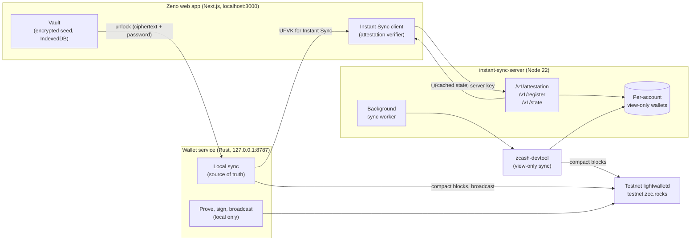
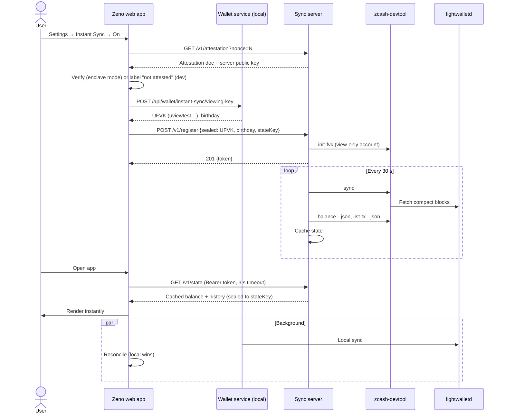
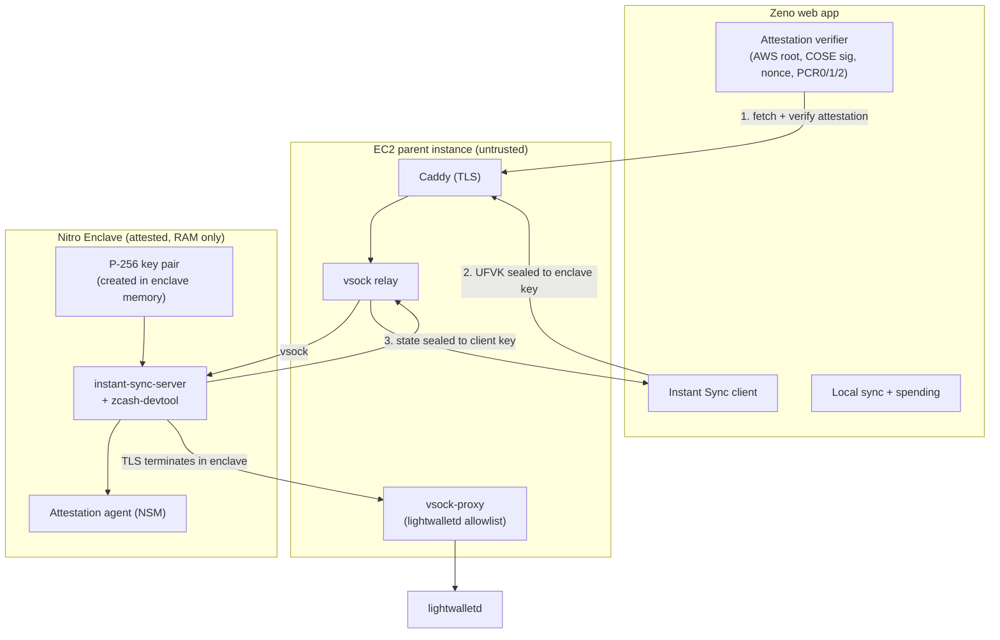
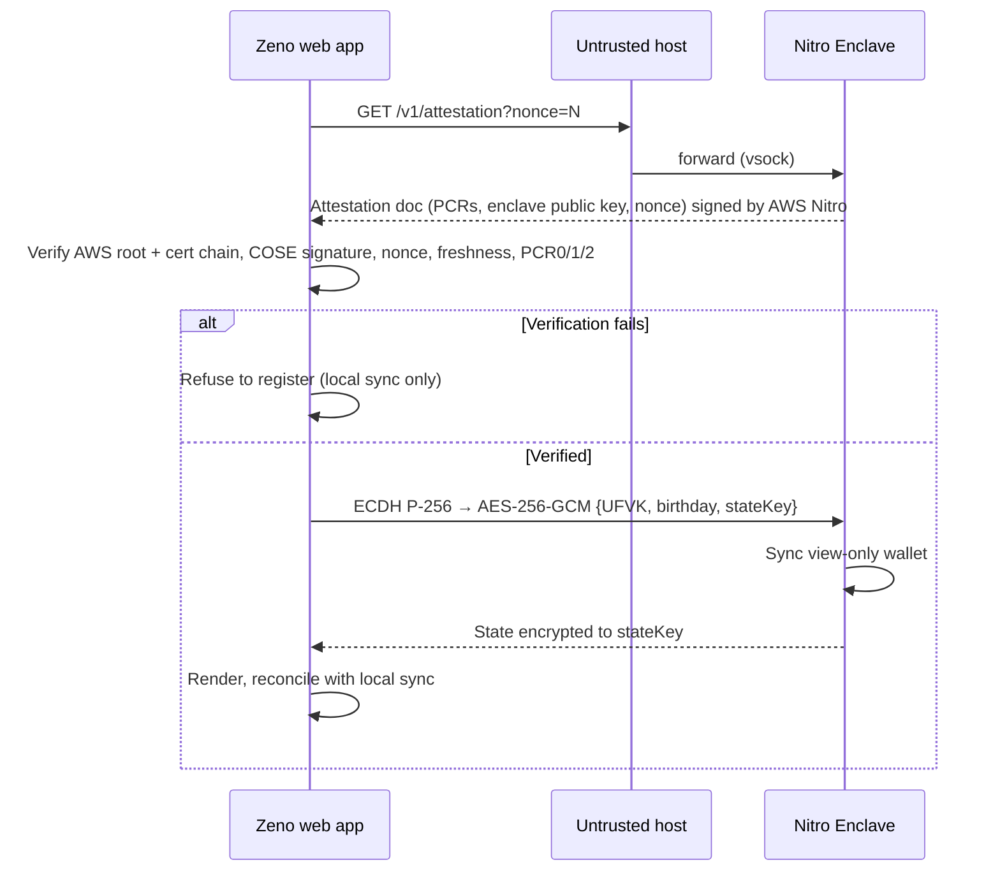

# Zeno

**The instant shielded Zcash wallet.** Zeno is a Zcash wallet that is shielded by default, signs on your own machine, shows you what others can see before you pay, and has **Instant Sync**: open the app and your private balance is already there.

> ⚠️ **Testnet only.** Built for the Free Society Hack 2026 (Mumbai), Privacy track. Instant Sync is opt-in. Its Nitro Enclave mode is implemented, but no attested build has been published yet, so today's sync servers run in "not attested" dev mode. Do not use mainnet keys.

---

## Why Zeno

Zcash's privacy depends on choices most users never see, and shielded wallets are slow to open.

- **Most usage is still transparent.** 73.5% transparent vs 6.3% shielded transactions ([Kappos et al., USENIX Security 2018](https://www.usenix.org/system/files/conference/usenixsecurity18/sec18-kappos.pdf)). Shielded supply grew from ~11% to ~30% in 2025, mostly through partially shielded flows ([Coin Metrics](https://coinmetrics.substack.com/p/state-of-the-network-issue-338)).
- **Users get stuck with transparent funds** from exchanges and mining rewards ([forum](https://forum.zcashcommunity.com/t/coinbase-rewards-sent-to-transparent-vs-shielded/43876), [ZecHub](https://zechub.substack.com/p/private-vs-transparent)).
- **Viewing keys exist, but [no tooling turns one into something an accountant can use](https://forum.zcashcommunity.com/t/is-anyone-actually-using-viewing-keys-for-business-accounting/56300).**
- **Shielded wallets make you wait.** They must trial-decrypt every shielded output since you last opened the app. Sync time scales with the **whole chain's activity**, not yours.

Zeno keeps your **viewing key** synced on a server, so that work is already done when you open the app. In enclave mode the server runs inside an **AWS Nitro Enclave** and the browser verifies its attestation before sending the key, so the operator cannot read it (see [Trusted Execution Environment](#trusted-execution-environment)).

| Moment | Typical shielded wallet | Zeno with Instant Sync |
|---|---|---|
| Open after a few days | Wait for catch-up scan | Cached balance shown instantly (~2 ms from the server) |
| Incoming payment | Visible after next scan | Picked up on the server's next resync (every 30 s) |
| First sync of a wallet | Scan from birthday in the client | Server scans from birthday (41.7 s for the demo wallet) |

## Features

- 🛡️ **Shielded by default:** receive, send and faucet funding use the shielded unified address. Transparent is opt-in and labeled public, and you can shield transparent funds in one tap.
- 🔍 **Privacy review before every send:** plain-language checks for shielded receiver, swap provider involvement, fee, and what your network connection still reveals. Requirements are re-checked at approval.
- 🌲 **Ironwood (NU7):** Ironwood notes received and spent on testnet, shown on their own balance row.
- 🏷️ **Pay by name:** `alice.zcash` resolves through the Zcash Names indexer into the same review.
- 🔑 **Scoped viewing keys:** export a viewing key for a *dedicated* account and scan it read-only at `/audit`.
- ⚡ **Instant Sync (opt-in):** cached balance and history served from the sync server.
- 🔒 **Spending stays local:** proving and signing run in a loopback Rust service. No server ever receives a spending key.
- 🪂 **Graceful fallback:** if the sync server is down or slow (>3 s), Zeno silently uses local sync.
- 🧩 **Wallet everywhere:** the same wallet panel runs on the dashboard, in the header, and as a browser-extension popup.
- 🔁 **NEAR Intents swaps (mainnet, experimental):** a swap exit exists at `/swap`, but 1Click has no testnet, so it is outside this testnet submission and has not been exercised with funds.

---

## Architecture



**How Instant Sync works**



1. The user turns on Instant Sync. The app fetches the server's attestation and public key, gets the primary account's **UFVK** from the local wallet service, encrypts it to the server, and registers. It receives a session token.
2. The server imports the key as a **view-only** account and resyncs it every 30 seconds.
3. When the app opens, it fetches the **cached** state and renders it immediately.
4. Local sync keeps running in the background. If the two disagree, local wins. Spending only ever uses local state.

---

## Repository layout

```
.
├── frontend/                   # Next.js 16 web app (dashboard, /audit, /popup for the extension)
├── engine/
│   └── services/
│       └── wallet-service/     # Rust: seed vault, sync, quote, prove, sign, broadcast, faucet proxy
├── instant-sync-server/
│   ├── server.mjs              # zero-dependency Node 22 server
│   ├── sealed.mjs              # ECDH P-256 + AES-256-GCM sealed registration and state
│   ├── enclave/                # Nitro Enclave image, attestation agent, parent services, build.sh
│   ├── test/                   # mock devtool + mock attestation, smoke and enclave tests
│   ├── Dockerfile              # builds zcash-devtool + server image
│   ├── docker-compose.yml      # server + Caddy (auto TLS)
│   ├── Caddyfile
│   └── DEPLOY.md
├── extension/                  # MV3 popup that frames localhost:3000/popup
├── docs/                       # wallet, payments, disclosure, privacy review
└── DEMO.md
```

`backend/` (legacy Nest scaffold) and `engine/services/payment-api` are not used by any page.

---

## Getting started

### Prerequisites

- Node 22+
- Rust toolchain (`curl https://sh.rustup.rs -sSf | sh`)
- git
- Internet access to `testnet.zec.rocks`
- Docker (optional, for the deploy image)

### 1. Build the sync engine (optional, for Instant Sync)

Start this first; it takes 10–20 minutes.

```bash
git clone https://github.com/zcash/zcash-devtool
cd zcash-devtool
cargo build --release
# binary: target/release/zcash-devtool
```

### 2. Run the wallet service

```bash
cd engine/services/wallet-service
WALLET_NETWORK=testnet WALLET_API_BIND=127.0.0.1:8787 WALLET_DATA_DIR=$PWD/wallet-data \
LIGHTWALLETD_ENDPOINT=https://testnet.zec.rocks:443 cargo run --release
```

It binds to loopback only and accepts requests only from `http://localhost:3000`. **Never expose port 8787**: create and unlock are not behind a bearer token.

### 3. Run the sync server (optional)

```bash
cd instant-sync-server
PORT=8795 HOST=127.0.0.1 \
DEVTOOL_BIN=/path/to/zcash-devtool/target/release/zcash-devtool \
npm start
```

### 4. Run the tests (no network needed)

```bash
cd instant-sync-server
npm test
```

### 5. Run the web app

```bash
cd frontend
cp .env.example .env.local
# set NEXT_PUBLIC_WALLET_BACKEND=live
# for Instant Sync, also set NEXT_PUBLIC_INSTANT_SYNC_URL=http://127.0.0.1:8795
npm install && npm run dev
```

Open **http://localhost:3000** (not `127.0.0.1`; that is the only origin the services accept). Create or unlock a wallet, fund it from the faucet panel, then send from **Send**. To try Instant Sync, open **Settings → Instant Sync** and turn it on.

With `NEXT_PUBLIC_WALLET_BACKEND` unset or set to `simulated`, the app is a click-through UI that never broadcasts. `NEXT_PUBLIC_*` values are read at startup, so restart after changing them.

---

## Configuration

**Frontend** (`frontend/.env.local`)

| Variable | Default | Description |
|---|---|---|
| `NEXT_PUBLIC_WALLET_BACKEND` | `simulated` | `live` to use the local wallet service |
| `NEXT_PUBLIC_WALLET_URL` | `http://127.0.0.1:8787` | Testnet wallet service (must be loopback) |
| `NEXT_PUBLIC_INSTANT_SYNC_URL` | — | Sync server URL. Instant Sync is unavailable when unset |

**Sync server** (`instant-sync-server`)

| Variable | Default | Description |
|---|---|---|
| `PORT` | `8790` | HTTP port (8787/8788 are the local wallet services) |
| `HOST` | `0.0.0.0` | Bind address |
| `DEVTOOL_BIN` | `zcash-devtool` | Path to the `zcash-devtool` binary |
| `DATA_DIR` | `./data` | Wallet directories + `accounts.json` (mode 700) |
| `LWD_SERVER` | `zecrocks` | lightwalletd server alias |
| `SYNC_INTERVAL_MS` | `30000` | Background resync per account |
| `SYNC_CONCURRENCY` | `1` | Parallel account syncs |
| `ALLOWED_ORIGIN` | `http://localhost:3000` | CORS origin of the web app |
| `MAX_ACCOUNTS` | `100` | Registration cap |
| `BALANCE_MIN_CONFIRMATIONS` | `1` | Matches the local wallet service so balances reconcile |
| `TRUST_PROXY` | `0` | `1` behind Caddy so rate limits use `X-Forwarded-For` |
| `ENCLAVE` | `0` | `1` inside the Nitro Enclave |
| `REQUIRE_SEALED` | = `ENCLAVE` | Refuse plaintext `{ufvk}` registrations |
| `ALLOW_MAINNET` | `0` | Must stay `0`; `uview1` keys are refused |

Full list in [instant-sync-server/README.md](./instant-sync-server/README.md).

---

## API

All authenticated routes take `Authorization: Bearer <token>`.

### `GET /v1/attestation?nonce=<hex>`

In an enclave: `{ "attested": true, "document": "<base64 Nitro attestation>" }`, which binds the server's public key and your nonce. Outside an enclave: `{ "attested": false, "document": null, "publicKey": "…" }` (same encryption, no proof).

### `POST /v1/register`

```json
{ "sealed": { "epk": "…", "iv": "…", "ct": "…" } }
```

`ct` is `{ ufvk, birthday, stateKey }` encrypted with ECDH P-256 → HKDF-SHA256 → AES-256-GCM. Dev servers also accept a plaintext `{ "ufvk": "uviewtest1…", "birthday": 3000000 }`.

→ `201 { "token": "…", "status": "registering" }`

Only testnet UFVKs (`uviewtest…`) are accepted. Spending keys, seed phrases and mainnet keys get `400`. Rate limit: 5 per hour per IP.

### `GET /v1/state`

Returns the cached state immediately (sealed to `stateKey` for sealed registrations):

```json
{
  "status": "ready",
  "balance": {
    "total": "78975000",
    "ironwood_spendable": "78975000",
    "orchard_spendable": "0",
    "sapling_spendable": "0",
    "transparent_spendable": "0"
  },
  "txs": [{ "txid": "…", "mined_height": 4561983 }],
  "chainTipHeight": 4562010,
  "lastSyncedAt": "2026-11-04T12:00:00Z",
  "stalenessMs": 4200
}
```

Balances are zatoshi strings. Status is one of `registering`, `syncing`, `ready`, `error`.

### `DELETE /v1/account`

Stops any running sync and deletes the account's data.

### `GET /health`

Liveness and queue info.

---

## Trust model

**Instant Sync is opt-in and off by default.**

| | Dev server (not attested) | Nitro Enclave mode |
|---|---|---|
| Funds at risk? | **No.** Spending keys never leave your machine | No |
| Server sees history? | Yes, the operator is trusted. Settings labels it "not attested" | No. Keys, balances and txids live only in enclave RAM |
| Verifiable code? | Open source | Reproducible build; the client checks PCR0/1/2 against the published measurements |

**What everyone in the picture can see**

- **On chain:** for shielded-to-shielded sends, sender, recipient, amount and memo are encrypted. Transparent sends are public, and the app says so before you approve.
- **Your seed:** encrypted in the browser (Argon2id + ChaCha20-Poly1305, stored in IndexedDB). Decrypted only by the wallet service on `127.0.0.1`, in memory, while unlocked.
- **lightwalletd (`testnet.zec.rocks`):** sees your IP address, when you sync, and the bytes of transactions you broadcast. It cannot decrypt shielded notes.
- **Instant Sync operator (dev mode):** can see all of the primary account's shielded activity, including future activity. A viewing key cannot be revoked; turning Instant Sync off deletes the server's copy.
- **No Zeno account, analytics, or remote log.**

**Server security measures**

- View-only keys only; anything else is rejected
- Tokens stored only as SHA-256 hashes
- UFVKs and tokens are never logged; errors are redacted
- Data directory permissions are `700`
- Known limitation: the UFVK appears in the child process arguments. On a shared host any local user can see it in `ps`; inside the enclave there are no other users.

---

## Trusted Execution Environment

A sync server has to see a viewing key to find your notes. Running it in an **AWS Nitro Enclave**, an isolated VM with no disk, no direct network and no operator access, makes that key unreachable to the host OS and the operator. The browser hands over the key only after verifying, through remote attestation, that the enclave is running the exact open-source build we published.

**Status:** implemented in code (server, enclave image, attestation agent, parent services, in-browser verifier, reproducible build). The first attested deployment and its published PCRs are still pending, so `frontend/src/features/instant-sync/enclave-measurements.json` has `null` PCRs and clients currently treat servers as "not attested".

### Architecture



### Attestation and key exchange



### Design decisions

| Decision | Choice | Why |
|---|---|---|
| TEE platform | AWS Nitro Enclaves | No extra cost (pay for EC2 only), built-in attestation, no SGX-style memory limits |
| Channel | ECDH P-256 + HKDF + AES-256-GCM to a key bound in the attestation doc | TLS terminates on the parent, so it can't protect against the operator. The host relays ciphertext only |
| Code integrity | Reproducible build (pinned images, crates, BuildKit, `SOURCE_DATE_EPOCH`) + committed PCRs | Anyone can run `./enclave/build.sh --verify`; the client refuses unknown and debug-mode builds |
| Persistence | None: wallet data lives in enclave RAM | Restarting the enclave wipes it; clients get `401` and re-register automatically |
| Network | Outbound only to lightwalletd via an allowlisted `vsock-proxy` | The enclave can't phone home anywhere else |
| No fallback | When PCRs are published, a failed attestation means no registration | A downgrade to a non-enclave server can't be forced |

### Threat model

| Threat | Mitigation |
|---|---|
| Malicious operator or host OS | Enclave memory is isolated; the host sees bearer tokens, ciphertext sizes and timing only |
| Swapped or backdoored server code | Client verifies PCR0/1/2 against the published reproducible build |
| Traffic analysis | **Not covered yet:** the enclave does not hide that an account exists, when it syncs, or response sizes |
| Denial of service | The operator can delete accounts or stop the server; the client falls back to local sync |
| Enclave compromise (e.g. side channel) | **Funds stay safe**: no spending keys, ever. Exposure is the viewing key's history |
| Trust in AWS hardware | Documented assumption; the path to zero-trust is Tachyon oblivious sync |

### Running an enclave

Full steps in [instant-sync-server/DEPLOY.md](./instant-sync-server/DEPLOY.md#nitro-enclave-deployment). In short:

```bash
# On a Nitro-enabled EC2 instance (c6i.xlarge, Nitro Enclave enabled at launch)
sudo dnf install -y aws-nitro-enclaves-cli aws-nitro-enclaves-cli-devel socat jq
sudo cp enclave/parent/allocator.yaml enclave/parent/vsock-proxy.yaml /etc/nitro_enclaves/
sudo systemctl enable --now nitro-enclaves-allocator

# Reproducible build → enclave/out/instant-sync.eif + measurements.json (commit it, redeploy the frontend)
DEVTOOL_REF=<zcash-devtool commit> ALLOWED_ORIGIN=https://<app-origin> ./enclave/build.sh

sudo install -D enclave/out/instant-sync.eif /opt/zeno/instant-sync.eif
sudo cp enclave/parent/*.service /etc/systemd/system/
sudo systemctl enable --now zeno-lwd-proxy zeno-enclave zeno-vsock-in
nitro-cli describe-enclaves | jq '.[0].Measurements'   # must equal enclave/measurements.json
```

Never run with `--debug-mode` in production: debug enclaves report all-zero PCRs and clients refuse them.

---

## Deployment

See [instant-sync-server/DEPLOY.md](./instant-sync-server/DEPLOY.md). In short: an EC2 **c6i.xlarge** in `ap-south-1` with **Nitro Enclave enabled at launch**, running `docker compose up -d` behind Caddy for automatic TLS, or the enclave setup above.

The frontend can be deployed on its own (e.g. Vercel). Without a local wallet service it runs in simulated mode; the live wallet needs the Rust service on the user's machine.

---

## Roadmap

- [x] **v0:** Instant Sync server on testnet, web integration, local fallback
- [x] **M1:** AWS Nitro Enclave, attestation verification in the client, reproducible builds *(first attested deployment and published PCRs pending)*
- [ ] **M2:** IVK-only mode (receive-only visibility), response padding, security audit
- [ ] **M3:** Nym for lightwalletd traffic, send and review inside the extension popup, viewing-key export to accountant-ready CSV
- [ ] **M4:** open-source client SDK for other wallets, mainnet beta, migration path to Tachyon oblivious sync

---

## Demo

See [DEMO.md](./DEMO.md): cold-open the same wallet with Instant Sync off vs on with the timer visible, then watch a shielded payment land.

**Testnet evidence**, found by Instant Sync from the demo wallet's viewing key via `testnet.zec.rocks`:

| txid | Mined | What |
|---|---|---|
| `f9dbb8bb655113e6d1f65efe3bfc4e8202bb3b375e96ec7ed2fbc55968c7d689` | 4,560,716 | Received 1.00 TAZ, Ironwood |
| `c2267ce983ca1f530015b13424f7bfc9090cbfe4eccffae41779594089150c76` | 4,561,446 | Sent 0.0101 TAZ, shielded (Ironwood change) |
| `fdf1921e895c9472426d787402c8cf23b1d17269011068bb3c450320ac8f9eea` | 4,561,983 | Sent 0.20015 TAZ, shielded (Ironwood change) |

First sync for this wallet: **41.7 s** from birthday to ready; cached state then serves in ~2 ms. Ironwood spendable reported: 0.78975 TAZ, matching the two sends.

<!-- TODO before submitting: add the shielded txid sent during the hack on 2026-11-04 here. -->

More detail: [wallet](./docs/wallet.md) · [shielded payments](./docs/shielded-payments.md) · [selective disclosure](./docs/selective-disclosure.md) · [privacy review](./docs/privacy-workspace.md) · [extension](./extension/README.md)

---

## Built with

- [zcash-devtool](https://github.com/zcash/zcash-devtool) and [librustzcash](https://github.com/zcash/librustzcash) (`zcash_client_backend`, `zcash_client_sqlite`, `zcash_keys`)
- Rust (axum, tonic), Next.js 16, React 19, Tailwind, [zcashname-sdk](https://www.npmjs.com/package/zcashname-sdk)
- AWS Nitro Enclaves, Node.js, Caddy, Docker
- [NEAR Intents](https://near.org) (mainnet swap exit, experimental)

## License

TBD

---

Built by **Sweta Karar** · ArcGenesis Labs
